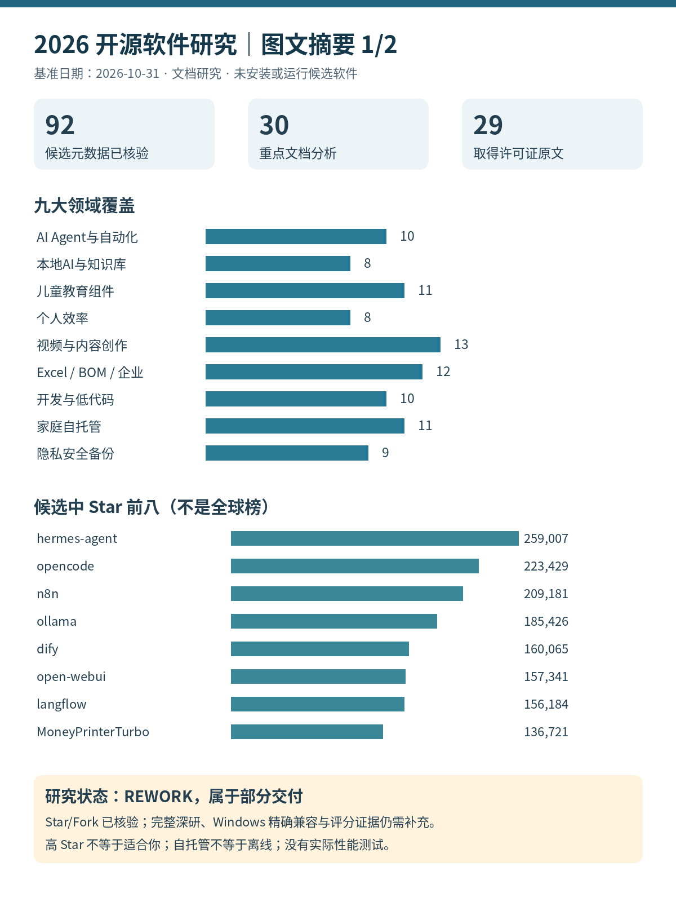
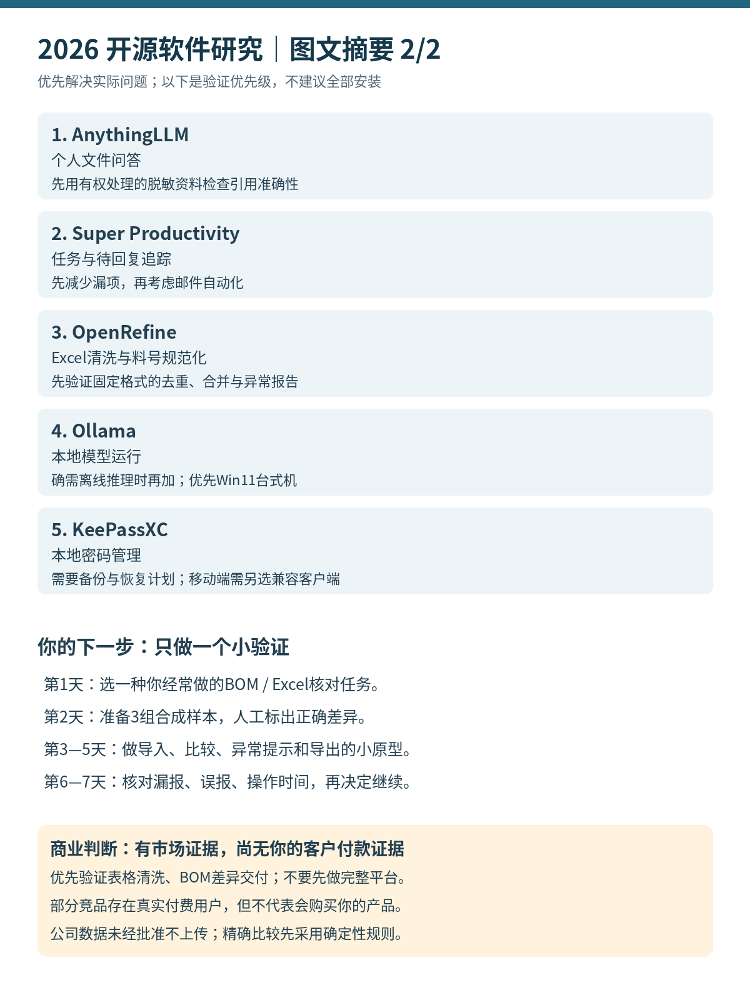

# 2026开源软件研究

## 详细图文PDF（2026-11-01新增）

[打开105页详细PDF](visual/OPEN_SOURCE_VISUAL_REPORT.pdf) · [PDF生成检查](review/PDF_VALIDATION.md)

PDF整合21份报告、付费需求补充、原创图表、目录书签和来源附录，已嵌入中文字体。点击PDF文件页即可预览或下载；早期PDF缺失说明是历史状态，研究REWORK结论不变。

## 直接查看图文摘要

完整HTML请打开文件后点击 Download raw file，下载到电脑后用浏览器打开；GitHub文件页通常显示源码，不会直接运行HTML。

[付费需求与收费软件替代补充研究](reports/21_PAID_DEMAND_AND_BUILDABLE_ALTERNATIVES.md)

2026-11-01经用户授权归档到codex-ext1。原报告“未提交/推送”是研究当时状态。原始GitHub证据完整保存于[data/RAW_EVIDENCE.zip](data/RAW_EVIDENCE.zip)，解压到data/后恢复raw/目录，再运行报告脚本。

研究基准与采集日期：2026-10-31（UTC，日内快照，不是当日收盘）。候选 92 个，精确元数据核验 92 个；≥1万 Star 82 个，≥10万 Star 12 个；原始许可证文件取得 29 个；另对12项具体用户故障报告取得详情（不代表当前故障率）。30 项重点文档分析（LibreChat受阻），不等于30项完整深度验证。没有安装或运行任何候选软件。

最有收益的顺序是：先用一个任务清单、一个文档问答入口、一个表格清洗工具；再决定是否需要模型运行器和自动化。不要同时部署多个聊天平台、多个工作流平台。

推荐是进一步验证的优先级，不是“全部已证实好用”。GitHub元数据完整度高，功能、Win10精确版本、中文质量、90天全量维护、付款需求证据仍不完整。研究整体须附限制阅读，未达到原请求全部验收条件。

## 阅读入口

- [最终摘要](FINAL_SUMMARY.md)
- [完整图文HTML](visual/OPEN_SOURCE_VISUAL_REPORT.html)（主体完全内嵌，离线可读，A4打印）
- [独立审查](review/INDEPENDENT_REVIEW.md)
- [最终验收](review/FINAL_ACCEPTANCE.md)
- [范围](RESEARCH_SCOPE.md) / [方法](RESEARCH_METHOD.md) / [数据CSV](data/github_projects.csv) / [证据登记](data/sources.md)

## 报告目录

- [01_EXECUTIVE_SUMMARY](reports/01_EXECUTIVE_SUMMARY.md)
- [02_OPEN_SOURCE_LANDSCAPE](reports/02_OPEN_SOURCE_LANDSCAPE.md)
- [03_TOP_100_PROJECTS](reports/03_TOP_100_PROJECTS.md)
- [04_TOP_30_DEEP_RESEARCH](reports/04_TOP_30_DEEP_RESEARCH.md)
- [05_AI_AGENTS_AUTOMATION](reports/05_AI_AGENTS_AUTOMATION.md)
- [06_LOCAL_AI_KNOWLEDGE](reports/06_LOCAL_AI_KNOWLEDGE.md)
- [07_CHILDREN_EDUCATION](reports/07_CHILDREN_EDUCATION.md)
- [08_PRODUCTIVITY_TOOLS](reports/08_PRODUCTIVITY_TOOLS.md)
- [09_VIDEO_CREATION](reports/09_VIDEO_CREATION.md)
- [10_BUSINESS_EXCEL_TOOLS](reports/10_BUSINESS_EXCEL_TOOLS.md)
- [11_DEV_SELFHOST_PRIVACY](reports/11_DEV_SELFHOST_PRIVACY.md)
- [12_COMPARISON_MATRIX](reports/12_COMPARISON_MATRIX.md)
- [13_USER_FIT_RANKING](reports/13_USER_FIT_RANKING.md)
- [14_COMMUNITY_COMPLAINTS](reports/14_COMMUNITY_COMPLAINTS.md)
- [15_BUSINESS_OPPORTUNITIES](reports/15_BUSINESS_OPPORTUNITIES.md)
- [16_RECOMMENDED_COMBINATIONS](reports/16_RECOMMENDED_COMBINATIONS.md)
- [17_TOP_10_RECOMMENDATIONS](reports/17_TOP_10_RECOMMENDATIONS.md)
- [18_TOP_5_ACTION_PLAN](reports/18_TOP_5_ACTION_PLAN.md)
- [19_RISKS_AND_LIMITATIONS](reports/19_RISKS_AND_LIMITATIONS.md)
- [20_FINAL_VERDICT](reports/20_FINAL_VERDICT.md)

## 再生成

仅运行自写报告脚本 `python scripts/build.py`，不联网、不运行候选软件；读取已有JSON生成CSV/Markdown/SVG/HTML。PDF自动生成受阻：现有Chromium无法创建默认用户目录；指定/tmp目录后又因crashpad setsockopt权限错误退出。未安装依赖，也未伪造PDF。HTML已有A4样式，可在浏览器打印→保存为PDF。日志见data/pdf_generation.log。
